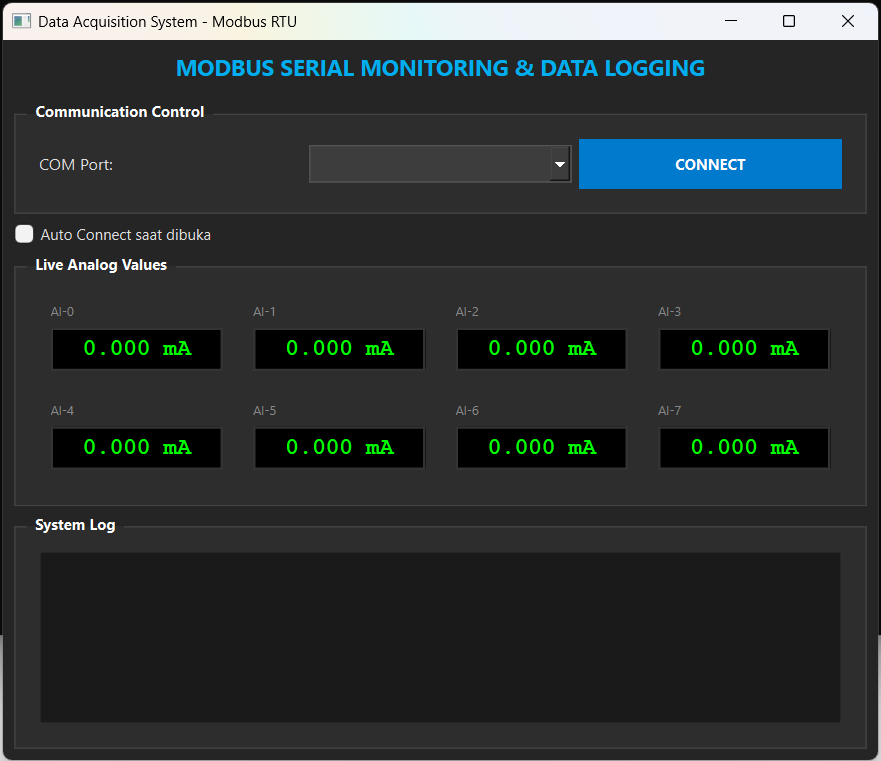

# Modbus → MySQL

Aplikasi untuk membaca data dari perangkat berbasis protokol Modbus dan menyimpan hasil pembacaan ke database MySQL.

## Tampilan Aplikasi



## Fitur

- Komunikasi dengan perangkat Modbus.
- Pembacaan data register secara berkala.
- Penyimpanan data ke database MySQL.
- Konfigurasi koneksi perangkat dan database.
- Pemantauan proses komunikasi dan penyimpanan data.

## Arsitektur Sistem

```text
Perangkat Modbus
      │
      ▼
Aplikasi Modbus
      │
      ▼
Pemrosesan Data
      │
      ▼
Database MySQL
```

## Persyaratan

- Python 3.x
- Perangkat yang mendukung protokol Modbus
- Database MySQL
- Koneksi komunikasi yang sesuai dengan perangkat, seperti RS-485 atau TCP/IP
- Library Python sesuai kebutuhan aplikasi

## Instalasi

### 1. Clone Repository

```bash
git clone https://github.com/Kumpi-dx/modbus_adam.git
cd modbus_adam
```

### 2. Buat Virtual Environment (Opsional)

```bash
python -m venv venv
```

Windows:

```bash
venv\Scripts\activate
```

### 3. Instal Dependensi

Jika repository menyediakan `requirements.txt`, jalankan:

```bash
pip install -r requirements.txt
```

### 4. Konfigurasi

Sesuaikan konfigurasi perangkat Modbus dan database MySQL dengan lingkungan Anda, termasuk:

- Alamat IP atau port serial perangkat.
- Slave ID.
- Baud rate jika menggunakan komunikasi serial.
- Parameter register yang dibaca.
- Host, port, username, dan database MySQL.

Jangan menyimpan password atau kredensial database di repository publik.

## Menjalankan Aplikasi

Jalankan file utama aplikasi sesuai struktur proyek. Contoh:

```bash
python main.py
```

Sesuaikan perintah tersebut jika nama file utama berbeda.

## Alur Kerja

1. Aplikasi menginisialisasi koneksi ke perangkat Modbus.
2. Aplikasi membaca register sesuai konfigurasi.
3. Data hasil pembacaan diproses.
4. Data disimpan ke database MySQL.
5. Proses pembacaan diulang sesuai interval yang ditentukan.

## Troubleshooting

| Masalah | Pemeriksaan |
|---|---|
| Gagal terhubung ke perangkat | Periksa IP, port, kabel, dan parameter komunikasi |
| Data register tidak sesuai | Periksa alamat register, function code, dan tipe data |
| Gagal menyimpan ke MySQL | Periksa koneksi database, hak akses, dan struktur tabel |
| Library tidak ditemukan | Instal dependensi dari `requirements.txt` |
| Data tidak diperbarui | Periksa interval polling dan log aplikasi |

## Kontribusi

Kontribusi, laporan bug, dan saran pengembangan sangat dipersilakan melalui GitHub Issues atau Pull Requests.

## License

Lisensi proyek belum ditentukan. Tambahkan file `LICENSE` jika proyek akan didistribusikan secara publik.

---

**Modbus → MySQL**  
Industrial Data Acquisition & Database Integration

